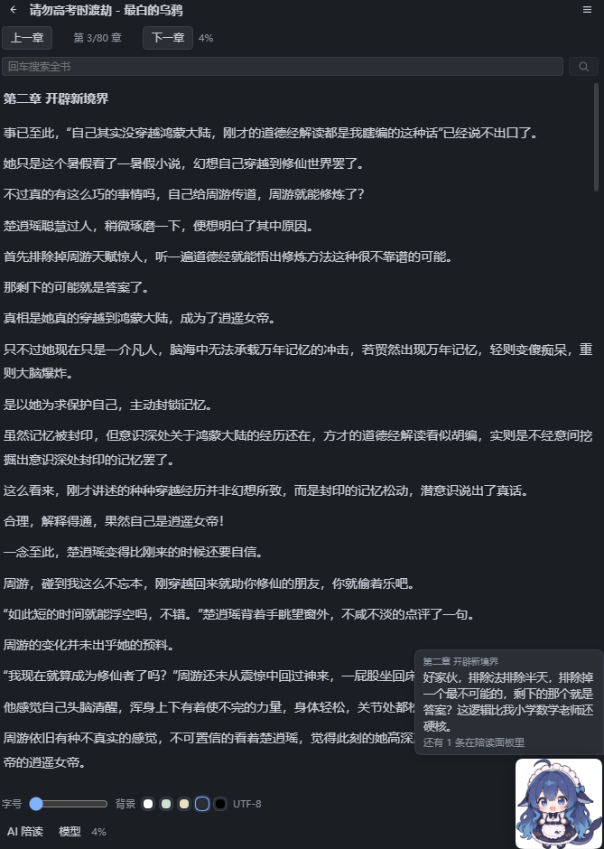
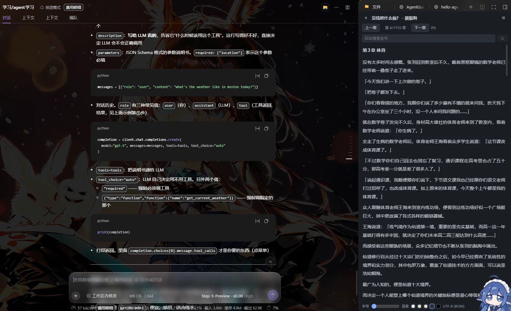

# dsh-novel-shelf

**办公摸鱼专用**：在 DSH（DeepSeek Harness）右侧栏里看本地 txt 小说，边看小说边做项目。v0.2.0 起还带一个 **AI 陪读**，边读边吐槽。English version: [README.en.md](README.en.md)







## v0.4.0 新增 / What's new in v0.4.0

这一版解决的是最根本的问题：**读者不该自己去找书**。

- **内置公版中文书库，434 本**：书架工具栏多了一个书库按钮，打开就是一份书目——《西遊記》《紅樓夢》《三國志演義》《水滸傳》《封神演義》《聊齋志異》《儒林外史》《老殘遊記》这些都在，可搜书名或作者，点「下载」直接进书架开读。不用找 txt、不用填路径、不用配书源。
- **来源是 Project Gutenberg 的中文藏书**：插件只内置**书目**（44 KB 的 JSON），正文在你点下载时才从 CDN 取，不占安装包体积。
- **下载即入库**：落到 `%APPDATA%/novel-reader/public-domain/`，之后完全离线可读；重复下载同一本不会变成两本。
- **四个 CDN 自动回退**：`cdn.jsdelivr.net` → `gcore` → `testingcf` → `fastly`，哪个通走哪个。
- **正文自动剥掉 Gutenberg 的页眉页脚**：授权说明、`Produced by`、`*** START/END OF THE PROJECT GUTENBERG EBOOK ***`、文件命名说明全部去掉，打开就是「第一回」。《西遊記》实测 2.24 MB、切出 90 回，下载耗时约 1 秒。

## v0.3.0 新增 / What's new in v0.3.0

这一版补上了书架最缺的东西：**能自己把书导进来**，不用先去文件管理器里翻绝对路径。

- **三条导入路径**：工具栏的 `+` 打开导入面板——**选文件**（也可以直接把 txt 拖进来）、**浏览目录**、**手填路径**，都通向同一个书架。
- **浏览目录是零复制**：宿主自己 `readdir` 拿到真实路径，点「导入」就把原文件路径记进书架，不搬、不复制、不占第二份磁盘。只列一层、只显示 `.txt`（网文目录几千个文件，递归会卡死面板），带「上一层 / 主目录」跳转。
- **选文件才存副本**：浏览器拿不到真实路径（`File.path` 早没了），所以这条路把字节传给宿主，宿主在 `%APPDATA%/novel-reader/imported/` 存一份带内容哈希的副本。同一个文件重复导入会命中原名，不会变成两本。
- **移除即清副本**：从书架移除时，只有 `imported/` 下的副本会被删掉；**你原来那份文件永远不会被碰**。
- **上传上限 100 MB**：网络小说 txt 十几兆很常见，配置通道那条 1 MiB 的限制对上传单独放宽，其余接口照旧。

## v0.2.0 新增 / What's new in v0.2.0

这一版把「AI 陪读」做成了真正能用的东西，也修掉了几个用着难受的毛病：

- **陪读常驻，不再藏在面板里**：以前轮询器挂在「AI 陪读」面板上，面板一关轮询就停、悬浮人物也没了。现在开关一开就**立刻说一句**，然后按你设的间隔继续；面板收起时右下角的人物和气泡照样在。
- **右下角悬浮人物 + 气泡**：阅读时有个小人站在右下角吐槽，点它展开气泡看历史吐槽。
- **模型可以自己挑**：在「模型」面板里列出 DSH 已注册的 provider 和它们的模型，直接选；也可以自己填 **OpenAI 兼容端点 + API key**（baseURL / apiKey / 模型名），走你自己的额度。
- **报错说人话**：之前只会显示「模型没有返回内容」，现在直接告诉你是**哪个路由**出的问题、**什么原因**（key 无效 / 没登录 / 模型名不存在 / 额度不足），provider 自己没配好时错误也直接摆在面板里。
- **切会话不丢阅读页**：之前切到别的会话再回来会退回书架首页，现在阅读状态按会话记住，回到原处接着看。

## 功能 / Features

- **右侧栏阅读**：作为 DSH 原生右栏标签打开，不开新窗口、不切应用，主界面继续留着你的项目，小说和干活同时进行。
- **本地 txt 书架**：三条路加书——选文件 / 浏览目录 / 手填绝对路径。选文件由宿主存一份副本；浏览与手填都是零复制，插件只读取原文件，不上传、不外发。
- **内置公版书库（434 本）**：书目随包分发，点下载才取正文，落盘后离线可读。来源 Project Gutenberg。详见 [公版书库是怎么来的](#公版书库是怎么来的--how-the-public-domain-library-works)。
- **自带三本书**：装上就有三本小说，首次打开右栏时自动装进书架，不用自己找文件、不用配置路径。想删就删，删了不会再回来。
- **章节切分**：识别「第 N 章 / 节 / 回 / 卷 / 篇」标题；识别不到时按长度分段兜底。
- **编码探测**：UTF-8 / UTF-8 BOM / UTF-16LE / UTF-16BE / GB18030 自动判定。
- **全书搜索**：章节内全文匹配，命中给出章节名与上下文片段。
- **阅读进度**：章节号与滚动比例自动回写，重开自动回到原处。
- **五套配色**：白 / 护眼绿 / 米黄 / 深灰 / 纯黑，与 [novel-reader](https://github.com/) 的 `body[data-theme]` 同名同色。
- **与 novel-reader 共用数据**：读写 `%APPDATA%/novel-reader` 下的 `books.json`、`settings.json`、`annotations/*.json`，两边切换主题/进度即时同步。
- **零依赖**：只用 Node 内置模块与 DSH 宿主自带的服务，不引入第三方运行时依赖。插件只在两种情况下联网：你主动打开 AI 陪读，或你在公版书库里点「下载」。
- **AI 陪读（默认关闭）**：开着之后 AI 每隔一段时间就着刚读到的内容吐槽一句，可选毒舌/温柔/侦探/摆烂四种风格，也可以点「现在就说」立刻来一句。开关一开就自动开口，**不必先展开面板**；右下角常驻一个陪读人物和吐槽气泡。模型可在「模型」面板里从 DSH 已注册的 provider 里挑，也可自己填 OpenAI 兼容端点 + API key。不开就一次都不调用模型。详见 [docs/ai-companion.md](docs/ai-companion.md)。

### 内置书目是怎么装上的 / How the bundled books work

插件 bundle 里带一个 `books/` 目录（约 7.3 MB，三本 txt），随安装包一起分发。**绝不把本机的 `D:\...` 绝对路径写进书架**——换台机器路径不存在，书架会直接坏掉。所以流程是：

1. 首次读取书架（`library.get`）时，host 半边检查 `books.json` 里缺哪本内置书；
2. 缺的那几本从 bundle 的 `books/` **复制**到 `%APPDATA%/novel-reader/books/<书名>.txt`；
3. 再把这份**数据目录内的副本路径**写进 `books.json`，书架里就出现了。

三条硬约束：幂等（按书名判重，不会重复加）、失败不影响书架（某本复制失败只 `console.warn` 后继续）、**用户删过的不会再回来**（删一本就把书名记进 `removed-bundled.json`）。测试用环境变量 `NOVEL_SHELF_BOOKS_DIR` 把 bundle 目录指到沙箱，所以单测不依赖真实仓库里的小说。

### 公版书库是怎么来的 / How the public-domain library works

书架工具栏的书库按钮背后是 `catalog/zh.json`——**只有书目，没有正文**，44 KB / 434 本，每条记 `{id, title, author, downloads, repo}`。正文按需从 CDN 取：

1. 点「下载」→ `catalog.download` 按 `id` 找到那条书目；
2. 依次试四个 jsDelivr 边缘（`cdn` → `gcore` → `testingcf` → `fastly`），路径是 `https://<host>/gh/GITenberg/<repo>@master/<id>-0.txt`；
3. 拿到字节后剥掉 Gutenberg 的授权页眉、`Produced by` 行、`*** START/END ***` 标记与文件命名说明，只留正文；
4. 存到 `%APPDATA%/novel-reader/public-domain/<id>-<书名>.txt`，再走和本地导入同一条 `addBookAt` 入库。

**为什么是 GITenberg**：Project Gutenberg 官方站与常见镜像在部分网络下不通，而 GITenberg 是它的 GitHub 镜像组织，可以借 jsDelivr 的 CDN 取到。仓库名规则是「标题里每个非 ASCII 字母数字字符替换成一个 `-`」，带副标题的会失配，所以生成目录时用 GitHub 搜索兜底（434 本里 345 本靠规则、89 本靠搜索）。目录生成脚本思路记在 `docs/`，不在运行时跑。

**为什么只放书目不放正文**：434 本正文约 900 MB，塞进包里既装不下也没必要——绝大多数人只读其中几本。

## 安装 / Install

### 方式一：插件市场（推荐）

在 DSH 的插件市场里搜索 `dsh-novel-shelf`，点安装。

### 方式二：命令行

```sh
dsh plugin --profile desktop add good-saltfish/dsh-novel-shelf
```

### 方式三：从源码安装

```sh
git clone https://github.com/good-saltfish/dsh-novel-shelf
dsh plugin --profile desktop add link:<仓库路径>
```

### 方式四：手动装 tarball

从 [Releases](https://github.com/good-saltfish/dsh-novel-shelf/releases) 下载 `dsh-novel-shelf-<版本>.tgz`，然后：

```sh
dsh plugin --profile desktop add file:<tgz 路径>
```

> **装完必须刷新 DSH 页面**。插件的 client 半边是随页面加载的，安装或升级都不会热替换已加载的模块。刷新后右栏会出现「小说书架」标签。

## 使用步骤 / Usage steps

1. **打开右栏**：点 DSH 界面右上角的右栏按钮，展开右侧列。
2. **切到「小说书架」标签**：右栏顶部标签栏里选「小说书架」，进入书架页。
3. **三本内置书已经在架**：第一次打开时，插件自带的三本小说会自动复制到本机数据目录并加进书架，点开就能读。
4. **想读公版名著：点书库按钮**。工具栏上那个书本图标打开**公版书库**，434 本书目都在里面，搜书名或作者（例如「紅樓」），点某一行的「下载」，几百毫秒到一两秒后这本书就进了书架，点开直接读。下载过的会标「已加入书架」，重复点不会重复入库。
5. **继续加书**：点工具栏的 **`+`** 打开导入面板，三条路随便挑——
   - **选文件**：点「选文件」，或直接把 txt 拖进面板。浏览器只肯把字节交给网页，拿不到真实路径，所以这一条由宿主在 `%APPDATA%/novel-reader/imported/` 下落一份副本再记进书架（文件名带内容哈希前 16 位，同一个文件重复导入不会变成两本）。
   - **浏览目录**：点「浏览目录」，宿主自己列目录（只列一层，只显示 `.txt`），点「导入」即加入书架，**零复制**，书架里记的就是原文件路径。网文目录动辄几千个文件，所以只列一层、不递归。
   - **手填路径**：书架底部的输入框里填绝对路径（例如 `D:\books\foo.txt`），按回车。和「浏览目录」完全等价。
6. **开始读**：点书名进入阅读页，当前章节正文直接显示在右栏里。
7. **翻章与导航**：顶部「上一章 / 下一章」翻章，标题栏右侧的目录按钮展开章节列表，搜索框做全书全文检索（回车搜索，命中会给出章节名与上下文片段）。
8. **调阅读体验**：底部滑块调字号，底部五个色板切换背景（白 / 护眼 / 米黄 / 深灰 / 纯黑）。
9. **进度自动保存**：章节号与滚动比例写回 `%APPDATA%/novel-reader/annotations/<id>.json`，关掉再开自动回到原处。
10. **想要陪读**：点底部 **「AI 陪读」** → 打开开关，立刻就有第一句吐槽；右下角会出现陪读人物，点它看气泡。间隔与风格在同一个面板里调。
11. **换模型**：点底部 **「模型」**，从 DSH 已注册的 provider 里挑一个，或自填 OpenAI 兼容端点 + API key；点「测试」会真发一次请求，成功给样例、失败说明是哪个路由出了什么问题。不配就用 DSH 的默认模型。

> 右侧栏宽度有限，直接把窗口拉宽或切到更宽的布局阅读更舒服。

## 它是怎么工作的 / How it works

理解这几步有助于自己改这个插件：

1. **Host 半边（`lib/host.js`）** 在 `ctx.effect()` 里用 `ctx.webServer.register({kind:'prefix', path:'/novel-shelf/api'})` 挂一条前缀路由，对外提供 23 个方法：书架 `library.get` / `library.add` / `library.scan` / `library.upload` / `library.remove`，正文 `book.open` / `book.chapter` / `book.save` / `book.search`，设置 `settings.save`，模型 `model.options` / `model.save` / `model.reset` / `model.test`，陪读 `companion.get` / `companion.config` / `companion.tick` / `companion.nudge` / `companion.clear`，诊断 `client.log`，以及按会话记阅读页的 `reader.session.get` / `reader.session.set`。
2. **每条请求先过信任栅栏**：`ctx.connection.requestRejection(req)` 判定是否来自可信的浏览器会话（命令行直连一律 403），再叠加 `Sec-Fetch-Site` 跨站拒绝；方法名用 `Object.hasOwn(api, method)` 做白名单，`Object.hasOwn` 防的是 `POST /novel-shelf/api/constructor` 这类原型成员命中；请求体上限 1 MiB，只有 `library.upload` 单独放宽到 100 MiB（base64 会膨胀 4/3，上限按同样的比例算）。
3. **Host 半边做真正的 IO**：读盘、编码探测、章节切分、全文检索、JSON 落盘（写临时文件再 rename；读到损坏 JSON 先备份成 `*.corrupt-<时间戳>` 再回退，不静默覆盖）。路径一律 `path.resolve` 归一。
4. **Client 半边（`lib/client.js`）** 通过 `window.__ModuleLoader__.load({id:'dsh-novel-shelf', factory})` 挂载。它先 `ctx.inject(['sidebarRight','sidebarRightTabs'], ...)` 拿到右栏标签注册表，注册一个 tab 类型（`id = dsh-novel-shelf/reader`，`kind = dsh-novel-shelf:reader`），再通过 `ctx.slots.inject('sidebar.right.pane.tab', ...)` 占用两个 keyed 座位（正文与标题）。
5. **座位注入回调必须返回清理函数**，否则宿主不会真正占位，面板会退化成宿主占位文案「这类内容还没有可用的查看方式」。这是 DSH 右栏插件最容易踩的坑。
6. **面板调 API**：client 侧把路径拼成 `novel-shelf/api/<method>`（去掉前导斜杠，挂在 `document.baseURI` 下），POST JSON，收到 `{ok:true,value}` 或 `{ok:false,error}`。
7. **主题与设置共享**：主题、字号、行距都写进 `%APPDATA%/novel-reader/settings.json`，桌面版 novel-reader 读同一份文件，所以两边即时同步。

## 数据位置 / Data layout

| 文件 | 内容 |
| --- | --- |
| `%APPDATA%/novel-reader/books.json` | 书架（路径、名称、大小、加入时间） |
| `%APPDATA%/novel-reader/books/` | 内置三本书的本机副本（首次打开书架时从 bundle 复制过来） |
| `%APPDATA%/novel-reader/imported/` | 通过「选文件 / 拖进来」导入的书所存下的副本；把书从书架移除时，这里的副本一起删掉，**你原来那份文件不会被碰** |
| `%APPDATA%/novel-reader/public-domain/` | 从公版书库下载的书，命名 `<Gutenberg id>-<书名>.txt`；下载后完全离线可读，从书架移除时这里的副本一起删掉 |
| `%APPDATA%/novel-reader/removed-bundled.json` | 你主动删掉的内置书名，删过就不会再自动装回来 |
| `%APPDATA%/novel-reader/settings.json` | 主题、字号、行距、最后阅读的书 |
| `%APPDATA%/novel-reader/annotations/<id>.json` | 每本书的批注与阅读进度 |
| `%APPDATA%/novel-reader/plugin-client.log` | 插件 client 半边的运行诊断日志（只含标签与计数，不含正文） |

Windows 用 `%APPDATA%`，macOS 用 `~/Library/Application Support/novel-reader`，Linux 用 `~/.config/novel-reader`。

JSON 文件损坏时插件会先备份为 `*.corrupt-<时间戳>` 再回退到空值，**不会静默覆盖原数据**。

## 隐私 / Privacy

- 全部数据留在本机插件数据目录。
- **不开 AI 陪读、不点书库下载时，插件不做任何网络请求**。开陪读后只有「你刚读到的那一小段原文」（约 6 个自然段、上限 1200 字）会发给你在 DSH 里配置的那一家模型服务商，不经任何第三方中转。想让原文完全不出本机，就别开这个开关。
- **书库下载只连 CDN**：你在公版书库里点「下载」时，插件向 jsDelivr 的边缘节点（`cdn` / `gcore` / `testingcf` / `fastly`）请求那一本公版书的正文。请求里只有 Gutenberg 的书籍 id 和仓库名，不带任何本机信息、不带你的书架、不带阅读记录；下载完就存本地，之后不再联网。
- 宿主路由带官方信任栅栏（`ctx.connection.requestRejection`）与跨站请求拒绝，命令行直连会被拒。
- 只接受 `.txt`；请求体上限 1 MiB；API 方法白名单用 `Object.hasOwn` 防原型成员。
- 陪读日志 `%APPDATA%/novel-reader/plugin-client.log` 只记标签与计数，不记正文。

## 开发 / Development

### 目录结构

```
lib/host.js            宿主半边：文件 IO、编码探测、章节切分、全文检索、JSON 落盘、HTTP 路由、模型目录与陪读
lib/client.js          客户端半边：右栏标签注册、书架/阅读页/陪读面板/模型面板、五套主题样式
assets/reader-avatar.png  陪读人物（右下角悬浮，PNG 约 114 KB）
books/                 内置的三本 txt（约 7.3 MB，随 bundle 分发，首次运行时复制到数据目录）
catalog/zh.json        公版书库书目（434 本，44 KB，只有元信息没有正文）
locale/zh.json         中文文案
locale/en.json         英文文案
docs/ai-companion.md    AI 陪读说明（模型怎么配、隐私边界）
docs/public-domain-library.md  公版书库：目录生成方法、命名规则、正文剥壳
docs/screenshot-*.png  截图
test/hosttest.mjs      宿主半边单测
test/smoke.mjs         客户端半边交互冒烟（自带极简 React 桩）
screenshots.json       插件市场截图声明
```

### 跑测试

```sh
npm test        # host 半边单测 + client 半边交互冒烟（自带极简 React 桩，无需 DSH 运行时）
```

### 打包与本地安装

```sh
npm pack --pack-destination .
dsh plugin --profile desktop add file:.\dsh-novel-shelf-0.2.0.tgz
```

改完 client 半边记得**刷新页面**再验证；改完 host 半边需要重装 bundle。

### 发一个版本

```sh
npm version patch
npm pack --pack-destination .
gh release upload v0.2.0 dsh-novel-shelf-0.2.0.tgz --repo good-saltfish/dsh-novel-shelf
```

Release 资产名建议带版本号（`dsh-novel-shelf-<版本>.tgz`），目录条目里用固定版本路径 `releases/download/v<版本>/<资产名>`，避免 `latest/download/` 在下个版本时 404。

### 提交到插件市场后：那个红灯不会自己变绿

`Submission gate` 会卡仓库年龄 1 天，这是硬门槛，过了就行。但**它是快照式的，只在 push 时重跑**。

理论上有个 `regate.yml` 每 6 小时重跑一次红灯，但它有 `MAX_RERUNS=20` 上限、且按 PR 号升序处理。这个目录现在编号已到八千多、排队很长，你的 PR 极可能排在 20 名之外 —— 于是"约 24 小时后自动转绿"这句话对队列尾部不成立，红灯会一直挂着没人推。

所以仓库满 1 天后，**自己往 fork 分支推一个空 commit** 触发一次重跑：

```sh
git commit --allow-empty -m "chore: re-trigger the submission gate (repository is now a day old)"
git -c http.version=HTTP/1.1 push origin <分支名>
```

空 commit 不改任何文件，只是让 CI 重新判定一次 —— 年龄够了就立刻转绿，PR 状态从 `UNSTABLE` 变 `CLEAN`。

推不上 GitHub（`Recv failure: Connection was reset`）时加 `-c http.version=HTTP/1.1`，实测能治。

另外：合并是维护者的手动动作。全绿之后没人 review 就只是排队，PR 下留一句礼貌的评论是唯一合规的推进方式。条目合进 upstream `main` 之前，插件市场搜不到 —— 市场读的是 `data/plugins/*.yml`，不在 `main` 上就是 404。

## License

MIT
